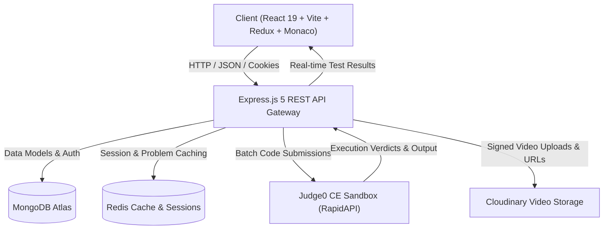

<div align="center">

# ⚡ SolveIt

### Full-Stack Algorithmic Problem Solving & Online Judge Platform

[](https://react.dev/)
[](https://vitejs.dev/)
[](https://nodejs.org/)
[](https://expressjs.com/)
[](https://www.mongodb.com/)
[](https://redis.io/)
[](https://tailwindcss.com/)
[](https://daisyui.com/)
[](https://microsoft.github.io/monaco-editor/)
[](https://rapidapi.com/judge0-official/api/judge0-ce)
[](https://cloudinary.com/)
[](LICENSE)

<p align="center">
  <b>A comprehensive, production-ready LeetCode alternative built to practice coding problems with real-time multi-language code execution, video editorial walkthroughs, AI algorithmic hints, community discussions, and user analytics.</b>
</p>

[Key Features](#-key-features) •
[Technical Highlights](#-engineering--technical-highlights) •
[System Architecture](#-system-architecture) •
[Tech Stack](#-tech-stack) •
[Quick Start](#-quick-start) •
[Environment Variables](#-environment-variables) •
[API Reference](#-api-reference) •
[Project Structure](#-project-structure)

---

</div>

## 🌟 Overview

**SolveIt** is a full-featured online judge and competitive programming platform engineered to provide an authentic technical interview preparation experience. Designed and implemented end-to-end, it integrates browser-based code editing, asynchronous sandboxed test case execution across multiple programming languages (C++, Java, JavaScript), on-demand video solutions, AI-assisted hint generation, problem bookmarking, personal study notes, discussion boards, and real-time leaderboard statistics.

---

## ✨ Key Features

- **💻 Monaco Code Editor**: Powered by the core editor behind Visual Studio Code, complete with syntax highlighting, auto-indentation, bracket matching, language switching (C++, Java, JavaScript), and theme toggling.
- **⚡ Sandboxed Code Execution**: Real-time batch code compilation and execution with hidden and sample test cases powered by the **Judge0 CE** execution sandbox via RapidAPI.
- **💡 AI Solution Hints & Strategy**: Guided hints, time & space complexity breakdowns, and algorithm intuition without directly giving away code solutions.
- **🎥 Video Editorial Walkthroughs**: Integrated video explanations with direct signed uploads to **Cloudinary** and adaptive streaming playback.
- **💬 Community Discussion Boards**: Per-problem discussion threads supporting Q&A, markdown explanations, comment threads, and upvoting.
- **📌 Personal Study Notes & Bookmarks**: Save private revision notes directly alongside code and filter bookmarked problems for rapid review.
- **🏆 Live Leaderboard & User Profiles**: Detailed profile analytics tracking solved problems categorized by difficulty (Easy, Medium, Hard), total submissions, accuracy metrics, and global ranking.
- **🌱 Automated Database Seeding**: Pre-loaded with classic technical interview challenges (Two Sum, Valid Anagram, Reverse Linked List, Binary Search, Longest Substring Without Repeating Characters, etc.) that seed automatically on backend startup.
- **🛡️ Admin Suite**: Administrative interface to create algorithmic problems, configure hidden test cases, and manage video tutorials.
- **🎨 Modern Dark & Light UI**: Responsive, accessible interface styled with Tailwind CSS v4 and DaisyUI 5.

---

## 💡 Engineering & Technical Highlights

- **Asynchronous Batch Execution**: Designed a polling batch submission worker with `axios` and Judge0 CE that compiles and runs multiple test cases concurrently, evaluating time and memory limits.
- **In-Memory Caching & Performance**: Integrated **Redis** for accelerated problem metadata querying and user session caching to minimize MongoDB database load.
- **Secure Direct-to-Cloud Media Uploads**: Built an authenticated Cloudinary signature endpoint (`/video/signature`) so heavy video files upload directly from client to cloud storage, eliminating backend bandwidth bottlenecks.
- **State Management & Routing**: Structured with **Redux Toolkit** for reactive, predictable global state (user authentication, active problem, submissions) and **React Router v7** for declarative client navigation.
- **Robust Auth & Security**: Implemented JWT-based stateless authentication with secure `httpOnly` cookie delivery, bcrypt salt-hashed passwords, and role-based access control middleware.
- **Zero-Config Database Auto-Seeding**: Automatic detection of empty problem collections on MongoDB launch with automatic batch population of curated standard interview questions.

---

## 🏗️ System Architecture



---

## 🛠️ Tech Stack

### Frontend
| Technology | Description |
| :--- | :--- |
| **React 19** | Modern declarative UI component library |
| **Vite 7** | Fast build tooling and Hot Module Replacement (HMR) |
| **Redux Toolkit** | Centralized predictable state management |
| **Monaco Editor** | The code editor that powers Visual Studio Code |
| **Tailwind CSS v4** | Modern utility-first styling engine |
| **DaisyUI v5** | Accessible semantic component system with theme support |
| **React Router v7** | Client-side routing and navigation |
| **Axios** | HTTP client with credentials and base URL interceptors |
| **Zod & React Hook Form** | Type-safe form validation and state handling |

### Backend
| Technology | Description |
| :--- | :--- |
| **Node.js** | Server runtime environment (v18+) |
| **Express.js 5** | High-performance backend web framework |
| **MongoDB & Mongoose** | Flexible NoSQL document database and schema validation |
| **Redis** | High-speed in-memory caching and session acceleration |
| **JWT & Bcrypt** | Secure JSON Web Token authentication and salted password hashing |
| **Judge0 CE** | Remote multi-language code compilation and batch test execution |
| **Cloudinary SDK** | Cloud media storage and video streaming optimization |

---

## 📋 Requirements & Prerequisites

For a complete manifest of dependencies, see [`requirements.txt`](requirements.txt).

- **Node.js**: `v18.0.0` or higher ([Download](https://nodejs.org/))
- **npm**: `v9.0.0` or higher
- **MongoDB**: Local MongoDB instance or free cloud cluster at [MongoDB Atlas](https://www.mongodb.com/atlas)
- **Redis**: Local `redis-server` or cloud instance at [Redis Cloud](https://redis.io/) / [Upstash](https://upstash.com)
- **Judge0 CE RapidAPI Key**: Free subscription at [RapidAPI Judge0 CE](https://rapidapi.com/judge0-official/api/judge0-ce)
- **Cloudinary Account**: Free account at [Cloudinary](https://cloudinary.com) for video storage

---

## 🚀 Quick Start

### 1. Clone the Repository
```bash
git clone https://github.com/Ananya92006/SolveIt.git
cd SolveIt
```

### 2. Install Dependencies
You can install dependencies for both `Backend` and `frontend` in one command:
```bash
npm run install:all
```
*Or manually:*
```bash
# Install backend dependencies
cd Backend
npm install

# Install frontend dependencies
cd ../frontend
npm install
```

---

### 3. Configure Environment Variables

#### Backend Configuration
Copy the template file:
```bash
cp Backend/.env.example Backend/.env
```
Open `Backend/.env` and update the values:
```env
PORT=3000
NODE_ENV=development
FRONTEND_URL=http://localhost:5173
DB_CONNECT_STRING=mongodb+srv://<username>:<password>@cluster.mongodb.net/solveit?retryWrites=true&w=majority
JWT_KEY=your_jwt_secret_key
ADMIN_SECRET_KEY=admin123
REDIS_PASS=your_redis_password_or_url
JUDGE0_KEY=your_rapidapi_judge0_key
CLOUDINARY_CLOUD_NAME=your_cloudinary_cloud_name
CLOUDINARY_API_KEY=your_cloudinary_api_key
CLOUDINARY_API_SECRET=your_cloudinary_api_secret
GEMINI_KEY=your_gemini_api_key
```

#### Frontend Configuration
Copy the frontend template:
```bash
cp frontend/.env.example frontend/.env
```
Ensure `VITE_API_URL` points to your backend:
```env
VITE_API_URL=http://localhost:3000
```

---

### 4. Run the Development Servers

#### Option A: From the Root Directory
```bash
# Terminal 1: Start Backend Server
npm run dev:backend

# Terminal 2: Start Frontend Application
npm run dev:frontend
```

#### Option B: Manually in Subdirectories
```bash
# Terminal 1: Backend (runs on http://localhost:3000)
cd Backend
npm start

# Terminal 2: Frontend (runs on http://localhost:5173)
cd frontend
npm run dev
```

Open [http://localhost:5173](http://localhost:5173) in your browser to start solving! 🎉

---

## 🔐 Environment Variables

### Backend (`Backend/.env`)

| Variable | Required | Description | Example / Default |
| :--- | :---: | :--- | :--- |
| `PORT` | No | Port on which the Express server listens | `3000` |
| `NODE_ENV` | No | Server environment mode | `development` / `production` |
| `FRONTEND_URL` | No | Frontend URL for CORS origin validation | `http://localhost:5173` |
| `DB_CONNECT_STRING` | **Yes** | MongoDB connection URI | `mongodb+srv://...` |
| `JWT_KEY` | **Yes** | Secret key for signing authentication tokens | `your_secret_key` |
| `ADMIN_SECRET_KEY` | No | Secret passcode to unlock admin mode | `admin123` |
| `REDIS_PASS` | **Yes** | Redis authentication password or URL | `redis_password` |
| `JUDGE0_KEY` | **Yes** | RapidAPI key for Judge0 CE code execution | `your_rapidapi_key` |
| `CLOUDINARY_CLOUD_NAME` | **Yes** | Cloudinary cloud name | `your_cloud_name` |
| `CLOUDINARY_API_KEY` | **Yes** | Cloudinary API key | `1234567890` |
| `CLOUDINARY_API_SECRET` | **Yes** | Cloudinary API secret | `your_api_secret` |
| `GEMINI_KEY` | No | Google Gemini API key for AI hints | `your_gemini_key` |

### Frontend (`frontend/.env`)

| Variable | Required | Description | Default |
| :--- | :---: | :--- | :--- |
| `VITE_API_URL` | No | Base URL of the backend API | `http://localhost:3000` |

---

## 🌐 API Reference

### Authentication (`/user`)
- `POST /user/register` — Register a new account
- `POST /user/login` — Sign in with email and password
- `POST /user/logout` — Invalidate user session and clear auth cookie
- `GET /user/profile` — Fetch current user profile, stats, solved count & notes
- `POST /user/upgrade-admin` — Upgrade account privileges with admin secret key
- `GET /user/leaderboard` — Retrieve global ranking and leaderboard metrics
- `POST /user/bookmark/:problemId` — Toggle problem bookmark status
- `POST /user/notes/:problemId` — Save personal study notes for a specific problem

### Problems (`/problem`)
- `GET /problem/getAllProblem` — List all published problems with difficulty & tags
- `GET /problem/problemById/:id` — Retrieve problem description, examples & starter templates
- `POST /problem/create` — Create a new problem with test cases *(Admin only)*
- `PUT /problem/update/:id` — Update existing problem data *(Admin only)*
- `DELETE /problem/delete/:id` — Remove a problem *(Admin only)*

### Submissions & Execution (`/submission`)
- `POST /submission/run/:id` — Execute code against sample test cases via Judge0
- `POST /submission/submit/:id` — Submit solution against all test cases and record verdict
- `GET /submission/history/:problemId` — Fetch user's previous submissions for a problem

### Video Walkthroughs (`/video`)
- `GET /video/signature` — Generate signed Cloudinary upload params *(Admin only)*
- `POST /video/create` — Link uploaded video editorial to a problem *(Admin only)*
- `GET /video/:problemId` — Retrieve video solution for a problem

### Community Discussions (`/discussion`)
- `GET /discussion/:problemId` — Get all discussions for a problem
- `POST /discussion/:problemId` — Create a new discussion post or question
- `POST /discussion/upvote/:id` — Upvote a discussion post
- `POST /discussion/comment/:id` — Add a reply comment to a discussion thread

---

## 📁 Project Structure

```
SolveIt/
├── requirements.txt            # System prerequisites, dependencies & services
├── package.json                # Root package with multi-service commands
├── README.md                   # Comprehensive project documentation
├── LICENSE                     # MIT License
├── .gitignore                  # Git ignore rules for node_modules, .env, etc.
├── vercel.json                 # Vercel deployment configuration
│
├── Backend/                    # Node.js + Express REST API
│   ├── .env.example            # Environment variables template
│   ├── .gitignore              # Backend-specific gitignore
│   ├── package.json            # Backend dependencies & start scripts
│   └── src/
│       ├── config/             # DB & Redis connection clients
│       │   ├── db.js           # Mongoose MongoDB connection
│       │   └── redis.js        # Redis cache client
│       ├── controllers/        # Business logic controllers
│       │   ├── userAuthent.js  # Auth, profile, notes & leaderboard
│       │   ├── userProblem.js  # Problem listing, execution & submissions
│       │   ├── videoSection.js # Cloudinary signatures & video links
│       │   └── discussionController.js # Community forum discussions
│       ├── middleware/         # Auth & role verification middleware
│       ├── models/             # Mongoose schemas (User, Problem, Submission, Discussion)
│       ├── routes/             # Express API route declarations
│       └── utils/              # Judge0 helpers, seed data & helpers
│
└── frontend/                   # React 19 + Vite Application
    ├── .env.example            # Frontend environment variables template
    ├── package.json            # Frontend dependencies & build scripts
    ├── vite.config.js          # Vite & Tailwind CSS plugins
    ├── index.html              # HTML shell
    └── src/
        ├── App.jsx             # Main routing and theme wrapper
        ├── components/         # Reusable UI components (Navbar, Editor, etc.)
        ├── pages/              # Pages (Homepage, ProblemPage, Profile, Leaderboard, etc.)
        ├── store/              # Redux slices & store configuration
        └── utils/              # Axios API client & helpers
```

---

## 🚢 Deployment

### Frontend (Vercel)
The project includes a root [`vercel.json`](vercel.json) ready for 1-click deployment on [Vercel](https://vercel.com):
1. Import your GitHub repository into Vercel.
2. The root `vercel.json` automatically handles building the `frontend/` directory.
3. In the Vercel dashboard, configure `VITE_API_URL` to point to your deployed backend URL.

### Backend (Render / Railway / AWS)
1. Deploy the `Backend/` directory as a Node.js web service.
2. Set the build command to `npm install` and start command to `node src/index.js`.
3. Add the environment variables from `Backend/.env.example` in your hosting dashboard.

---

## 📄 License

This project is licensed under the [MIT License](LICENSE).

---

<div align="center">
  <b>Developed by <a href="https://github.com/Ananya92006">Ananya</a></b>
  <br>
  <i>Portfolio Project Showcase • Built for High Performance & Scalability</i>
</div>
